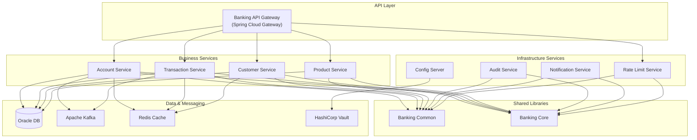

# Kế Hoạch Xây Dựng Banking Framework - Java Backend Hiện Đại

## Tổng Quan

Xây dựng một framework Java backend hiện đại, enterprise-grade cho hệ thống ngân hàng quy mô lớn (Core Banking System). Framework sử dụng kiến trúc **Microservices** với **Spring Boot 3.2.5**, **Java 21**, **Oracle Database**, và các công nghệ hiện đại như Kafka, gRPC, Redis, Resilience4j.

### Hiện Trạng Codebase

| Module | Trạng thái | Mô tả |
|--------|-----------|-------|
| `banking-common` | 🟡 Đã có 1 file | Chỉ có `BankingException.java` + `pom.xml` |
| `banking-core` | 🔴 Trống | Chỉ có thư mục cấu trúc |
| `banking-account-service` | 🔴 Trống | Chỉ có thư mục cấu trúc |
| `banking-transaction-service` | 🔴 Trống | Chỉ có thư mục cấu trúc |
| `banking-customer-service` | 🔴 Trống | Chỉ có thư mục cấu trúc |
| `banking-product-service` | 🔴 Trống | Chỉ có thư mục cấu trúc |
| `banking-audit-service` | 🔴 Trống | Chỉ có thư mục cấu trúc |
| `banking-notification-service` | 🔴 Trống | Chỉ có thư mục cấu trúc |
| `banking-rate-limit-service` | 🔴 Trống | Chỉ có thư mục cấu trúc |
| `banking-config-server` | 🔴 Trống | Chỉ có thư mục cấu trúc |
| `banking-api-gateway` | 🔴 Trống | Chỉ có thư mục cấu trúc |
| `banking-framework` | 🔴 Trống | Thư mục docs/scripts/config/common/core — trống |
| Parent `pom.xml` | ✅ Hoàn thành | Cấu hình đầy đủ dependencies, plugins, profiles |

### Technology Stack (từ pom.xml)

| Thành phần | Công nghệ | Phiên bản |
|-----------|-----------|----------|
| Language | Java | 21 |
| Framework | Spring Boot | 3.2.5 |
| Cloud | Spring Cloud | 2023.0.1 |
| Database | Oracle JDBC (ojdbc11) | 23.4.0.24.05 |
| ORM | Hibernate | 6.5.2.Final |
| Connection Pool | HikariCP | 5.1.0 |
| Messaging | Apache Kafka | 3.7.0 |
| RPC | gRPC + Protobuf | 1.63.0 / 3.25.3 |
| Cache | Redis (Lettuce) + Caffeine | 5.2.0 / 3.1.8 |
| Security | Vault + BouncyCastle | 6.3.0 / 1.78.1 |
| Monitoring | Micrometer + Prometheus | 1.13.0 |
| Resilience | Resilience4j | 2.2.0 |
| Mapping | MapStruct | 1.5.5.Final |
| Utility | Lombok | 1.18.32 |
| Testing | Testcontainers + Awaitility | 1.19.8 / 4.2.1 |
| Container | Jib (Eclipse Temurin 21) | 3.4.2 |

---

## User Review Required

> [!IMPORTANT]
> **Oracle Database**: Framework được thiết kế dùng Oracle DB. Bạn có muốn hỗ trợ thêm PostgreSQL hoặc H2 cho môi trường dev/test không?

> [!IMPORTANT]
> **Phạm vi triển khai**: Kế hoạch này rất lớn (~200+ files Java). Bạn muốn triển khai **tất cả** cùng lúc hay chia thành **nhiều giai đoạn** (Phase 1: Common + Core trước, Phase 2: Services...)?

> [!WARNING]
> **gRPC & Protobuf**: Cần thêm Maven plugin cho protobuf compilation. Bạn đã có `.proto` files sẵn chưa, hay cần tạo mới?

---

## Kiến Trúc Tổng Thể



---

## Proposed Changes

Kế hoạch chia thành **7 Phase** triển khai tuần tự:

---

### Phase 1: Banking Common (Foundation Layer)

Module chứa các class dùng chung cho toàn bộ framework.

#### [MODIFY] [BankingException.java](file:///home/dtc/Desktop/test/banking-common/src/main/java/com/banking/common/exception/BankingException.java)
- Giữ nguyên, đã tốt

#### [NEW] Exception & Error Handling Package
```
banking-common/src/main/java/com/banking/common/exception/
├── BankingException.java          (đã có)
├── ErrorCode.java                 # Enum error codes với HTTP status mapping
├── BusinessException.java         # Lỗi nghiệp vụ (insufficient funds, invalid account...)
├── TechnicalException.java        # Lỗi kỹ thuật (DB timeout, service unavailable...)
├── ValidationException.java       # Lỗi validation input
├── AuthenticationException.java   # Lỗi xác thực
├── AuthorizationException.java    # Lỗi phân quyền
├── ResourceNotFoundException.java # Không tìm thấy resource
├── DuplicateResourceException.java # Tài nguyên bị trùng
└── ConcurrencyException.java      # Lỗi xung đột concurrent (optimistic locking)
```

#### [NEW] Common DTOs & Response Package
```
banking-common/src/main/java/com/banking/common/dto/
├── ApiResponse.java               # Standard API response wrapper {success, data, error, traceId, timestamp}
├── PageRequest.java               # Phân trang request
├── PageResponse.java              # Phân trang response
├── ErrorDetail.java               # Chi tiết error response
├── SortField.java                 # Sort criteria
└── ValidationError.java           # Chi tiết validation error
```

#### [NEW] Common Constants
```
banking-common/src/main/java/com/banking/common/constant/
├── BankingConstants.java           # Constants chung toàn hệ thống
├── CurrencyCode.java              # ISO 4217 currency codes
├── TransactionType.java           # Enum các loại giao dịch
├── AccountType.java               # Enum loại tài khoản
├── AccountStatus.java             # Enum trạng thái tài khoản
├── TransactionStatus.java         # Enum trạng thái giao dịch
└── CustomerType.java              # Enum loại khách hàng
```

#### [NEW] Utilities
```
banking-common/src/main/java/com/banking/common/util/
├── DateTimeUtils.java             # Xử lý date/time banking (business date, settlement date)
├── MoneyUtils.java                # Arithmetic tiền tệ chính xác (BigDecimal)
├── MaskingUtils.java              # Che giấu thông tin nhạy cảm (account number, phone)
├── ValidationUtils.java           # Validation số tài khoản, CMND, mã thuế...
├── JsonUtils.java                 # JSON serialization/deserialization utilities
├── IdGenerator.java               # Tạo unique ID (UUID, snowflake, transaction reference)
└── ChecksumUtils.java             # Checksum validation cho số tài khoản
```

#### [NEW] Common Annotations
```
banking-common/src/main/java/com/banking/common/annotation/
├── Auditable.java                 # Mark method/class cần audit trail
├── RateLimit.java                 # Rate limiting annotation
├── Encrypted.java                 # Mark field cần mã hóa khi lưu
├── Idempotent.java                # Mark API idempotent
└── BankingValidation.java         # Custom validation constraints
```

#### [NEW] Event Base Classes
```
banking-common/src/main/java/com/banking/common/event/
├── DomainEvent.java               # Base domain event (id, timestamp, source, type)
├── EventMetadata.java             # Event metadata (correlation id, trace id)
├── EventPublisher.java            # Interface publish event
└── EventHandler.java              # Interface handle event
```

---

### Phase 2: Banking Core (Infrastructure Layer)

Module cung cấp các infrastructure component dùng chung: persistence, caching, security, messaging.

#### [NEW] `banking-core/pom.xml`
- Dependencies: banking-common, Spring Data JPA, Oracle JDBC, Redis, Kafka, gRPC, Vault, Security

#### [NEW] Persistence Layer
```
banking-core/src/main/java/com/banking/core/persistence/
├── entity/
│   ├── BaseEntity.java             # Abstract entity (id, createdAt, updatedAt, version)
│   ├── AuditableEntity.java        # Entity với full audit (createdBy, modifiedBy)
│   └── SoftDeletableEntity.java    # Soft delete support
├── repository/
│   ├── BaseRepository.java         # Generic repository interface extends JpaRepository
│   └── CustomQueryRepository.java  # Custom query support với Oracle-specific features
├── config/
│   ├── OracleDataSourceConfig.java  # Oracle DataSource + HikariCP configuration
│   ├── JpaConfig.java              # JPA/Hibernate configuration, naming strategy
│   ├── TransactionConfig.java      # Transaction manager config
│   └── FlywayConfig.java           # Database migration (Flyway)
├── converter/
│   ├── MoneyConverter.java          # BigDecimal precision converter
│   ├── EncryptedStringConverter.java # Transparent encryption cho sensitive fields
│   └── JsonColumnConverter.java     # JSON column mapping
├── specification/
│   └── BaseSpecification.java       # Dynamic query builder (JPA Criteria API)
└── interceptor/
    ├── AuditInterceptor.java        # Auto-fill audit fields
    └── EncryptionInterceptor.java   # Auto encrypt/decrypt marked fields
```

#### [NEW] Cache Layer
```
banking-core/src/main/java/com/banking/core/cache/
├── config/
│   ├── RedisCacheConfig.java        # Redis cache manager, serializer config
│   ├── CaffeineCacheConfig.java     # Local cache (L1) config
│   └── MultiLevelCacheConfig.java   # L1 (Caffeine) + L2 (Redis) cache strategy
├── service/
│   ├── CacheService.java           # Interface cache operations
│   ├── RedisCacheService.java      # Redis implementation
│   └── DistributedLockService.java # Redis-based distributed locking (Redisson)
└── key/
    └── CacheKeyGenerator.java       # Consistent cache key generation
```

#### [NEW] Security Layer
```
banking-core/src/main/java/com/banking/core/security/
├── config/
│   ├── SecurityConfig.java           # Spring Security config
│   ├── JwtConfig.java               # JWT token configuration
│   └── CorsConfig.java              # CORS policy
├── jwt/
│   ├── JwtTokenProvider.java         # JWT token generation & validation
│   ├── JwtAuthenticationFilter.java  # JWT authentication filter
│   └── JwtProperties.java           # JWT configurable properties
├── encryption/
│   ├── EncryptionService.java        # Interface mã hóa
│   ├── AesEncryptionService.java     # AES-256 encryption
│   ├── VaultEncryptionService.java   # HashiCorp Vault key management
│   └── KeyRotationService.java       # Key rotation support
├── auth/
│   ├── BankingUserDetails.java       # Custom UserDetails
│   ├── BankingAuthenticationProvider.java # Custom auth provider
│   └── PermissionEvaluator.java      # Fine-grained permission checking
└── audit/
    └── SecurityAuditLogger.java      # Log security events
```

#### [NEW] Messaging Layer
```
banking-core/src/main/java/com/banking/core/messaging/
├── kafka/
│   ├── config/
│   │   ├── KafkaProducerConfig.java   # Producer config (serializers, retries, idempotence)
│   │   ├── KafkaConsumerConfig.java   # Consumer config (deserializers, offset, group)
│   │   └── KafkaTopicConfig.java      # Topic auto-creation config
│   ├── producer/
│   │   ├── EventProducer.java         # Generic event producer
│   │   └── TransactionalEventProducer.java # Transactional outbox pattern
│   ├── consumer/
│   │   ├── EventConsumer.java         # Base consumer with retry/DLQ
│   │   └── IdempotentConsumer.java    # Idempotent message processing
│   └── serializer/
│       ├── BankingEventSerializer.java
│       └── BankingEventDeserializer.java
├── grpc/
│   ├── config/
│   │   ├── GrpcServerConfig.java      # gRPC server configuration
│   │   └── GrpcClientConfig.java      # gRPC client channel config
│   ├── interceptor/
│   │   ├── GrpcAuthInterceptor.java   # Authentication cho gRPC calls
│   │   ├── GrpcLoggingInterceptor.java
│   │   └── GrpcMetricsInterceptor.java
│   └── health/
│       └── GrpcHealthService.java     # gRPC health check
└── outbox/
    ├── OutboxEvent.java               # Outbox event entity
    ├── OutboxRepository.java          # Repository
    └── OutboxPublisher.java           # Scheduled outbox publisher
```

#### [NEW] Observability Layer
```
banking-core/src/main/java/com/banking/core/observability/
├── config/
│   ├── MetricsConfig.java            # Micrometer + Prometheus config
│   ├── TracingConfig.java            # Distributed tracing (Micrometer Tracing)
│   └── LoggingConfig.java            # Structured logging (JSON format)
├── metrics/
│   ├── BusinessMetrics.java          # Business metrics (TPS, success rate)
│   ├── DatabaseMetrics.java          # DB connection pool, query time
│   └── CustomMetricsRegistry.java    # Custom metrics registration
├── logging/
│   ├── StructuredLogger.java         # Structured logging wrapper
│   ├── MdcFilter.java               # MDC context propagation
│   └── SensitiveDataFilter.java     # Filter sensitive data từ logs
└── health/
    ├── OracleHealthIndicator.java    # Oracle DB health check
    ├── KafkaHealthIndicator.java     # Kafka health check
    └── RedisHealthIndicator.java     # Redis health check
```

#### [NEW] Resilience Layer
```
banking-core/src/main/java/com/banking/core/resilience/
├── config/
│   ├── CircuitBreakerConfig.java     # Circuit breaker defaults
│   ├── RetryConfig.java             # Retry policies
│   ├── RateLimiterConfig.java       # Rate limiting config
│   └── BulkheadConfig.java          # Bulkhead isolation
├── handler/
│   └── FallbackHandler.java         # Fallback strategies
└── decorator/
    └── ResilientServiceDecorator.java # Combine resilience patterns
```

#### [NEW] Web/API Layer
```
banking-core/src/main/java/com/banking/core/web/
├── config/
│   ├── WebMvcConfig.java             # MVC configuration
│   ├── JacksonConfig.java            # JSON serialization config (date format, BigDecimal)
│   └── AsyncConfig.java              # Async request handling
├── filter/
│   ├── RequestIdFilter.java          # Generate/propagate request ID
│   ├── RequestLoggingFilter.java     # Log request/response
│   └── ApiVersionFilter.java        # API versioning support
├── handler/
│   ├── GlobalExceptionHandler.java   # @ControllerAdvice exception handling
│   └── ValidationExceptionHandler.java # Bean validation error handling
├── interceptor/
│   ├── AuditInterceptor.java         # Audit trail interceptor
│   └── IdempotencyInterceptor.java   # Idempotency key check
└── advice/
    └── ResponseBodyAdvice.java       # Wrap response trong ApiResponse
```

---

### Phase 3: Business Services

#### 3.1 Account Service
```
banking-account-service/src/main/java/com/banking/account/
├── AccountServiceApplication.java
├── domain/
│   ├── entity/
│   │   ├── Account.java               # Tài khoản (số TK, loại, số dư, trạng thái, tiền tệ)
│   │   ├── AccountBalance.java         # Số dư tài khoản (available, hold, current)
│   │   ├── AccountHolder.java          # Chủ tài khoản (link to Customer)
│   │   └── AccountLimit.java           # Hạn mức tài khoản (giao dịch/ngày, số tiền)
│   ├── valueobject/
│   │   ├── AccountNumber.java          # Value object số tài khoản
│   │   ├── Money.java                  # Value object tiền tệ
│   │   └── Balance.java               # Value object số dư
│   ├── event/
│   │   ├── AccountCreatedEvent.java
│   │   ├── AccountClosedEvent.java
│   │   ├── BalanceChangedEvent.java
│   │   └── AccountFrozenEvent.java
│   └── service/
│       ├── AccountDomainService.java    # Domain logic
│       └── BalanceCalculationService.java
├── application/
│   ├── service/
│   │   ├── AccountService.java          # Interface
│   │   ├── AccountServiceImpl.java      # Implementation
│   │   ├── AccountQueryService.java     # CQRS Query
│   │   └── BalanceService.java          # Balance management
│   ├── dto/
│   │   ├── request/
│   │   │   ├── CreateAccountRequest.java
│   │   │   ├── UpdateAccountRequest.java
│   │   │   └── AccountQueryRequest.java
│   │   └── response/
│   │       ├── AccountResponse.java
│   │       ├── AccountDetailResponse.java
│   │       └── BalanceResponse.java
│   ├── mapper/
│   │   └── AccountMapper.java           # MapStruct entity ↔ DTO
│   └── validator/
│       └── AccountValidator.java        # Business rule validation
├── infrastructure/
│   ├── repository/
│   │   ├── AccountRepository.java
│   │   ├── AccountBalanceRepository.java
│   │   └── AccountJdbcRepository.java   # Native Oracle queries khi cần performance
│   ├── cache/
│   │   └── AccountCacheService.java
│   └── client/
│       ├── CustomerServiceClient.java   # gRPC client → Customer Service
│       └── ProductServiceClient.java
├── api/
│   ├── rest/
│   │   ├── AccountController.java       # REST endpoints
│   │   └── AccountAdminController.java  # Admin endpoints
│   └── grpc/
│       └── AccountGrpcService.java      # gRPC service cho internal calls
└── config/
    └── AccountServiceConfig.java
```

#### [NEW] `banking-account-service/src/main/resources/`
```
├── application.yml                     # Main config
├── application-dev.yml                 # Dev profile
├── application-prod.yml                # Production profile
├── db/migration/                       # Flyway migrations
│   ├── V1__create_account_tables.sql
│   └── V2__add_account_indexes.sql
└── proto/
    └── account-service.proto           # gRPC service definition
```

#### 3.2 Transaction Service
```
banking-transaction-service/src/main/java/com/banking/transaction/
├── TransactionServiceApplication.java
├── domain/
│   ├── entity/
│   │   ├── Transaction.java             # Giao dịch (amount, type, status, debit/credit accounts)
│   │   ├── TransactionEntry.java        # Bút toán kế toán (double-entry bookkeeping)
│   │   ├── TransactionLimit.java
│   │   └── TransactionFee.java          # Phí giao dịch
│   ├── valueobject/
│   │   ├── TransactionReference.java    # Mã tham chiếu giao dịch
│   │   └── TransactionAmount.java
│   ├── event/
│   │   ├── TransactionInitiatedEvent.java
│   │   ├── TransactionCompletedEvent.java
│   │   ├── TransactionFailedEvent.java
│   │   └── TransactionReversedEvent.java
│   └── service/
│       ├── TransactionDomainService.java
│       ├── FeeCalculationService.java
│       └── DoubleEntryService.java       # Bút toán kép
├── application/
│   ├── service/
│   │   ├── TransactionService.java
│   │   ├── TransactionServiceImpl.java
│   │   ├── TransferService.java          # Chuyển khoản (internal, interbank)
│   │   └── TransactionQueryService.java
│   ├── saga/
│   │   ├── TransferSaga.java             # Saga pattern cho chuyển tiền
│   │   └── SagaStep.java
│   ├── dto/
│   │   ├── request/
│   │   │   ├── TransferRequest.java
│   │   │   ├── DepositRequest.java
│   │   │   └── WithdrawRequest.java
│   │   └── response/
│   │       ├── TransactionResponse.java
│   │       └── TransactionHistoryResponse.java
│   └── mapper/
│       └── TransactionMapper.java
├── infrastructure/
│   ├── repository/
│   │   ├── TransactionRepository.java
│   │   └── TransactionEntryRepository.java
│   ├── messaging/
│   │   ├── TransactionEventProducer.java
│   │   └── TransactionEventConsumer.java
│   └── client/
│       └── AccountServiceClient.java     # gRPC to Account Service
├── api/
│   ├── rest/
│   │   └── TransactionController.java
│   └── grpc/
│       └── TransactionGrpcService.java
└── config/
    └── TransactionServiceConfig.java
```

#### 3.3 Customer Service
```
banking-customer-service/src/main/java/com/banking/customer/
├── CustomerServiceApplication.java
├── domain/
│   ├── entity/
│   │   ├── Customer.java                # Khách hàng (personal info, KYC status)
│   │   ├── CustomerDocument.java        # Giấy tờ tùy thân
│   │   ├── CustomerAddress.java
│   │   └── CustomerContact.java
│   ├── event/
│   │   ├── CustomerCreatedEvent.java
│   │   └── KycCompletedEvent.java
│   └── service/
│       ├── CustomerDomainService.java
│       └── KycService.java               # Know Your Customer
├── application/
│   ├── service/
│   │   ├── CustomerService.java
│   │   └── CustomerServiceImpl.java
│   ├── dto/                              # Request/Response DTOs
│   └── mapper/
│       └── CustomerMapper.java
├── infrastructure/
│   ├── repository/
│   │   └── CustomerRepository.java
│   └── client/
├── api/
│   ├── rest/
│   │   └── CustomerController.java
│   └── grpc/
│       └── CustomerGrpcService.java
└── config/
```

#### 3.4 Product Service
```
banking-product-service/src/main/java/com/banking/product/
├── ProductServiceApplication.java
├── domain/
│   ├── entity/
│   │   ├── Product.java                  # Sản phẩm ngân hàng
│   │   ├── InterestRate.java             # Lãi suất
│   │   ├── ProductFee.java               # Biểu phí sản phẩm
│   │   └── ProductTerm.java              # Kỳ hạn
│   └── service/
│       ├── ProductDomainService.java
│       └── InterestCalculationService.java
├── application/
│   ├── service/
│   │   ├── ProductService.java
│   │   └── ProductServiceImpl.java
│   ├── dto/
│   └── mapper/
├── infrastructure/
│   └── repository/
│       └── ProductRepository.java
├── api/
│   └── rest/
│       └── ProductController.java
└── config/
```

---

### Phase 4: Infrastructure Services

#### 4.1 Audit Service
```
banking-audit-service/src/main/java/com/banking/audit/
├── AuditServiceApplication.java
├── domain/
│   ├── entity/
│   │   ├── AuditLog.java                # Audit trail entry
│   │   └── AuditEvent.java              # Audit event details
│   └── service/
│       └── AuditDomainService.java
├── application/
│   ├── service/
│   │   ├── AuditService.java
│   │   └── AuditServiceImpl.java
│   └── dto/
│       └── AuditSearchRequest.java
├── infrastructure/
│   ├── repository/
│   │   └── AuditLogRepository.java
│   └── messaging/
│       └── AuditEventConsumer.java       # Consume audit events từ Kafka
├── api/
│   └── rest/
│       └── AuditController.java          # Search/query audit logs
└── config/
```

#### 4.2 Notification Service
```
banking-notification-service/src/main/java/com/banking/notification/
├── NotificationServiceApplication.java
├── domain/
│   ├── entity/
│   │   ├── Notification.java
│   │   └── NotificationTemplate.java
│   └── service/
│       └── NotificationDomainService.java
├── application/
│   ├── service/
│   │   ├── NotificationService.java
│   │   └── NotificationServiceImpl.java
│   ├── channel/
│   │   ├── EmailChannel.java
│   │   ├── SmsChannel.java
│   │   └── PushNotificationChannel.java
│   └── template/
│       └── TemplateEngine.java
├── infrastructure/
│   ├── repository/
│   │   └── NotificationRepository.java
│   └── messaging/
│       └── NotificationEventConsumer.java
└── config/
```

#### 4.3 Rate Limit Service
```
banking-rate-limit-service/src/main/java/com/banking/ratelimit/
├── RateLimitServiceApplication.java
├── domain/
│   ├── entity/
│   │   └── RateLimitRule.java
│   └── service/
│       └── RateLimitDomainService.java
├── application/
│   ├── service/
│   │   ├── RateLimitService.java
│   │   └── RateLimitServiceImpl.java
│   └── algorithm/
│       ├── TokenBucketAlgorithm.java
│       ├── SlidingWindowAlgorithm.java
│       └── FixedWindowAlgorithm.java
├── infrastructure/
│   ├── repository/
│   │   └── RateLimitRuleRepository.java
│   └── redis/
│       └── RedisRateLimitStore.java      # Redis-based rate limit counter
├── api/
│   └── rest/
│       └── RateLimitController.java
└── config/
```

#### 4.4 Config Server
```
banking-config-server/src/main/java/com/banking/config/
├── ConfigServerApplication.java
├── config/
│   ├── VaultConfig.java                  # Vault integration
│   ├── EncryptionConfig.java             # Config encryption
│   └── ConfigServerSecurityConfig.java
└── controller/
    └── ConfigRefreshController.java       # Dynamic config refresh
```

---

### Phase 5: API Gateway

```
banking-api-gateway/src/main/java/com/banking/gateway/
├── ApiGatewayApplication.java
├── config/
│   ├── GatewayConfig.java                # Route definitions
│   ├── SecurityConfig.java               # Gateway security
│   ├── RateLimitConfig.java              # Gateway rate limiting
│   └── CorsConfig.java
├── filter/
│   ├── AuthenticationFilter.java          # JWT validation filter
│   ├── RateLimitFilter.java              # Rate limiting filter
│   ├── RequestLoggingFilter.java
│   ├── CircuitBreakerFilter.java
│   └── ResponseModificationFilter.java
├── handler/
│   ├── GatewayExceptionHandler.java
│   └── FallbackHandler.java              # Fallback cho circuit breaker
└── route/
    └── RouteLocatorConfig.java            # Dynamic route configuration
```

---

### Phase 6: Configuration Files

#### [NEW] Application Config cho mỗi service
```
banking-*/src/main/resources/
├── application.yml                       # Common config
├── application-dev.yml                   # Dev profile
├── application-staging.yml               # Staging profile
├── application-prod.yml                  # Production profile
├── logback-spring.xml                    # Structured logging config
└── bootstrap.yml                         # Config Server bootstrap
```

#### [NEW] Protobuf Definitions
```
banking-common/src/main/proto/
├── common.proto                          # Shared protobuf types
├── account.proto                         # Account service
├── transaction.proto                     # Transaction service
├── customer.proto                        # Customer service
└── product.proto                         # Product service
```

#### [NEW] Database Migrations (per service)
```
banking-*/src/main/resources/db/migration/
├── V1__init_tables.sql
├── V2__add_indexes.sql
└── V3__add_constraints.sql
```

---

### Phase 7: Testing & Documentation

#### [NEW] Unit Tests (mỗi module)
```
banking-*/src/test/java/com/banking/*/
├── domain/service/*Test.java
├── application/service/*Test.java
├── api/rest/*ControllerTest.java
└── infrastructure/repository/*RepositoryTest.java
```

#### [NEW] Integration Tests
```
banking-*/src/test/java/com/banking/*/integration/
├── *IntegrationTest.java
└── TestContainerConfig.java              # Testcontainers setup
```

#### [NEW] Framework Documentation
```
banking-framework/docs/
├── architecture.md                       # Architecture overview
├── getting-started.md                    # Quick start guide
├── coding-standards.md                   # Coding conventions
├── api-guidelines.md                     # REST API standards
├── security-guidelines.md               # Security practices
└── deployment-guide.md                   # Deployment procedures
```

---

## Tổng Kết Số Lượng Files

| Phase | Module | Số files ước tính |
|-------|--------|------------------|
| 1 | banking-common | ~25 files |
| 2 | banking-core | ~55 files |
| 3a | banking-account-service | ~35 files |
| 3b | banking-transaction-service | ~35 files |
| 3c | banking-customer-service | ~20 files |
| 3d | banking-product-service | ~18 files |
| 4a | banking-audit-service | ~12 files |
| 4b | banking-notification-service | ~15 files |
| 4c | banking-rate-limit-service | ~12 files |
| 4d | banking-config-server | ~6 files |
| 5 | banking-api-gateway | ~12 files |
| 6 | Config files (all modules) | ~40 files |
| 7 | Tests + Docs | ~50+ files |
| **Tổng** | | **~335 files** |

---

## Open Questions

> [!IMPORTANT]
> **1. Phạm vi Phase đầu tiên**: Bạn muốn bắt đầu triển khai từ Phase nào? Khuyến nghị: **Phase 1 (Common) + Phase 2 (Core)** trước vì đây là nền tảng.

> [!IMPORTANT]
> **2. Database strategy**: Oracle DB cho production. Bạn có muốn dùng H2 embedded cho unit test và dev local không?

> [!WARNING]
> **3. gRPC vs REST**: Giữa các microservice nội bộ, bạn ưu tiên dùng gRPC (performance) hay REST (đơn giản hơn) cho internal communication?

> [!NOTE]
> **4. Event-driven**: Bạn muốn dùng **Transactional Outbox pattern** (đảm bảo exactly-once delivery) hay **direct Kafka publish** (đơn giản nhưng có risk mất event)?

> [!NOTE]
> **5. Authentication**: JWT self-contained tokens hay OAuth2 với Authorization Server (Keycloak)?

---

## Verification Plan

### Automated Tests
```bash
# Build toàn bộ project
mvn clean compile -pl banking-common,banking-core

# Run unit tests
mvn test -pl banking-common,banking-core

# Run integration tests
mvn verify -pl banking-account-service -P integration-test
```

### Manual Verification
- Kiểm tra tất cả module compile thành công
- Kiểm tra dependency graph giữa các module đúng
- Khởi động từng service và verify health endpoint
- Test API endpoints qua API Gateway
